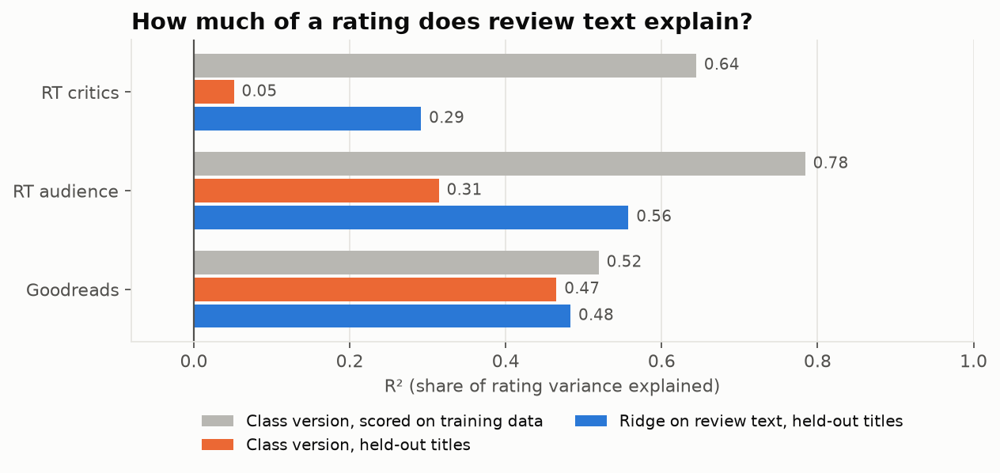
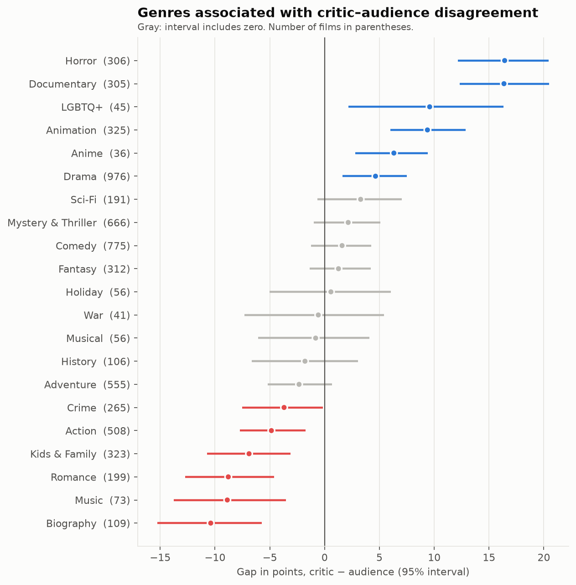

# What Makes a Story Stick?

### Critic and audience reception of films and books

Do the words in a review predict the rating it gives, and where do critics and audiences disagree? This project scrapes about 180,000 reviews from **Goodreads** (books) and **Rotten Tomatoes** (films, with separate critic and audience voices), cleans them, and tests each claim on data the model has never seen.

## Key findings

**1. Review text explains about half of reader and audience ratings on unseen titles, and about a quarter of critic ratings.** On a held-out 20% of books and films, TF-IDF + Ridge reaches R² 0.48 on Goodreads, 0.56 for RT audiences and 0.29 for RT critics.



| R² | Goodreads | RT audience | RT critics |
|---|---|---|---|
| Class version, scored on its own training data | 0.52 | 0.78 | 0.64 |
| Class version, held-out titles | 0.47 | 0.31 | 0.05 |
| Baseline: the title's published average | 0.06 | 0.30 | 0.50 |
| **Ridge on review text, held-out titles** | **0.48** | **0.56** | **0.29** |

**2. The original numbers were mostly overfitting.** The class version scored its models on their training data. On new films, its critic model falls from 0.64 to 0.05.

**3. Readers disagree about the same book; critics converge on a film.** Which book a review is about explains 6% of Goodreads ratings, against 48% from the words. For critics, the film's average critic score (0.50) predicts better than the critic's own words (0.29).

**4. Critics and audiences speak differently.** Critics' negative words are craft diagnoses (*inept*, *incoherent*, *misfire*, *fails*) with coefficients about half the size of audiences' blunt verdicts (*worst*, *garbage*, *terrible*). On Goodreads, *dnf* ("did not finish") is the strongest signal of a low rating.

**5. Horror and documentaries split critics from audiences the most.** Critics score both about 16 points higher than audiences (on a 0–100 scale), while audiences favor biographies, music films and romance by 9–10 points. Genre alone explains only 8–14% of film scores.



**6. The model misses pans that skip pan words.** In the 60 worst predictions: negation ("not a great movie"), sarcasm, objections to a book's message, and witty critic put-downs. That points to word-order-aware models next.

---

## Research questions

1. **Review language and reception.** Do the words reviewers use predict the rating they give, on held-out titles? Do critics, audiences and readers signal approval with different words?
2. **Genre and the critic–audience split.** Which genres are associated with higher or lower ratings, and which genres do critics and audiences disagree on?

Question 2 is a first pass. Three sharper questions are proposed to replace it (see [Next questions](#next-questions)).

---

## Data

Scraped in spring 2026. Sizes are after `data-cleaning.ipynb`.

| Dataset | Rows | Key fields |
|---|---|---|
| Goodreads books | 4,997 books | average rating, 1–5 star counts, genres, description |
| Goodreads reviews | 135,361 reviews (127,040 English) | rating (1–5), review text |
| Rotten Tomatoes movies | 3,001 films (2,454 with both scores) | Tomatometer, audience score, genres, release year, runtime, content rating |
| RT critic reviews | 25,136 reviews | rating (parsed to 0–5), fresh/rotten, review text |
| RT audience reviews | 15,264 reviews | score (0.5–5), review text |

The raw and cleaned CSVs are not in the repo. Scraped review text isn't mine to redistribute, and the Goodreads reviews file alone is about 370 MB.

---

## Repository

```
├── data-collection.ipynb   # Scrapers for Goodreads and Rotten Tomatoes -> data/*.csv
├── data-cleaning.ipynb     # Dedupe, join keys, language detection, text and rating cleaning, quality checks -> data/cleaned/
├── main.ipynb              # Analysis: held-out text models, word and genre associations with intervals
├── requirements.txt        # Pinned dependencies (tested on Python 3.14)
├── figures/                # Charts used in this README, exported from main.ipynb
└── data/                   # Not committed
    ├── goodreads-books.csv, goodreads-reviews.csv
    ├── rotten-tomatoes-movies.csv, rotten-tomatoes-critic-reviews.csv, rotten-tomatoes-audience-reviews.csv
    └── cleaned/            # Written by data-cleaning.ipynb
```

---

## Method

### Collection (`data-collection.ipynb`)

- Shared scraping layer: sync and async HTTP clients with exponential backoff, rotating user agents, handling for rate limits (429/403) and `Retry-After`, and a global pause so one rate-limit response pauses every concurrent request.
- Plugin design (`BaseDiscoverer`, `BaseDetailScraper`, `BasePipeline`), so a new source is a few subclasses.
- **Goodreads:** discovers Listopia lists by genre tag, then scrapes book pages asynchronously through the embedded `__NEXT_DATA__` Apollo cache.
- **Rotten Tomatoes:** Playwright for the JavaScript browse pages (on a background thread) feeding an async queue of detail and review scrapes.
- Resumable: discovered listings are cached to JSON, and CSVs are written in append mode.

### Cleaning (`data-cleaning.ipynb`)

- **Deduplication by ID,** not exact row. The same book scraped from several lists had slightly different counts, so exact matching missed 789 duplicate books and about 5,200 duplicate reviews.
- **Join keys:** reviews link to books by `book_id` and to films by URL, not by title (21 Goodreads titles belong to more than one book).
- **Language:** each review is labeled with [Lingua](https://github.com/pemistahl/lingua-py) (30 candidate languages, run on the raw text).
- **Text:** HTML, URLs and mojibake are removed. Accents are transliterated (`cliché` → `cliche`) rather than deleted, and remaining non-ASCII is removed.
- **Critic ratings:** `parse_critic_rating` turns 15+ formats (`3/5`, `B+`, `3 1/2 stars`, `7/10`, `Must Watch`, ...) into 0–5 and rejects off-scale values like `7.5/5`.
- **One 0–1 scale:** Goodreads (r − 1) / 4, RT audience (s − 0.5) / 4.5, critics r / 5.
- **Quality checks** fail the notebook if keys repeat, joins break, ratings leave 0–1, or text isn't clean.

### Analysis (`main.ipynb`)

- **Held-out by title.** 20% of books and films are held out, so every test review is of a title the model never saw.
- **Baselines.** Predict the average; predict the title's published average.
- **TF-IDF + Ridge,** with the penalty chosen by 5-fold cross-validation grouped by title, compared with the class version's unregularized regression scored both ways.
- **95% bootstrap intervals** (titles resampled 200 times) on every word coefficient. Only words whose interval excludes zero are interpreted.
- **Error analysis** of the 20 worst held-out predictions per platform.
- **Genre models** on films with both scores (no median-filling), genres with 30+ titles, and the critic − audience gap modeled directly, with repeated-CV R² and 1,000-resample intervals.

---

## Setup

```bash
python3 -m venv .venv
.venv/bin/pip install -r requirements.txt
.venv/bin/playwright install chromium     # only needed to re-scrape Rotten Tomatoes
```

Run the notebooks in order: `data-collection.ipynb` → `data-cleaning.ipynb` → `main.ipynb`. With the raw CSVs already in `data/`, skip collection. On a laptop, cleaning takes about 1.5 minutes and the analysis about 4.

To scrape, run one cell at the bottom of `data-collection.ipynb`:

```python
run_pipelines(["goodreads"])
run_pipelines(["rottentomatoes"])
```

---

## Next questions

Genre turned out to be a weak predictor, so three questions replace Question 2 (details at the end of `main.ipynb`):

1. **Where do critics and audiences disagree, and can we predict it?** Model the critic − audience gap for 2,454 films from genre, content rating, runtime, year, language, review volume and review text, and flag films likely to split by 20+ points. Early signal: PG-13 films average 12.8 points lower with critics than with audiences.
2. **What makes a book divisive?** Holding the average rating fixed, which books polarize readers (spread of 1–5 star ratings across 4,510 books)? Do genre, length, age or the book's description explain it?
3. **Do critics and audiences reward different things?** Tag review sentences for acting, writing, pacing, visuals and endings with a zero-shot model, and test whether aspect sentiment relates to ratings differently for critics and audiences.

---

## Limitations

- **Not a random sample.** Books come from popular Goodreads lists and films from RT browse pages, so ratings skew high.
- **Thin RT reviews.** The median film has about 10 critic and 6 audience reviews in this data.
- **English only** for the text models.
- **TF-IDF ignores word order** beyond two-word phrases.
- **Associations, not effects.** Coefficients describe which titles and reviews tend to score higher, not what would change a rating.
- **One snapshot.** Scores drift as reviews accumulate, especially for recent releases.

---

Started as a group class project and rebuilt (cleaning, evaluation and analysis) by Michael-Andre Odusami.
