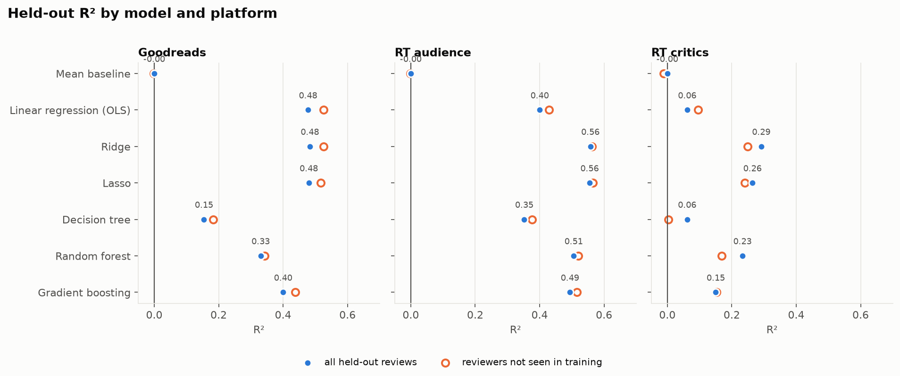
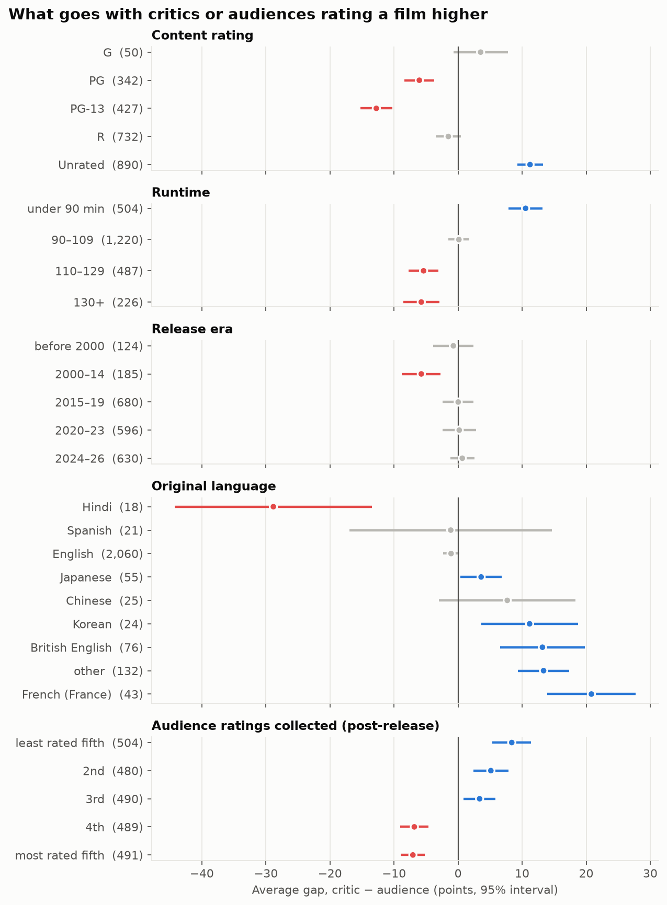
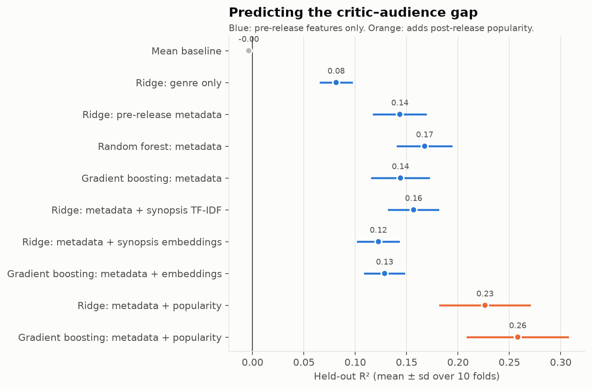
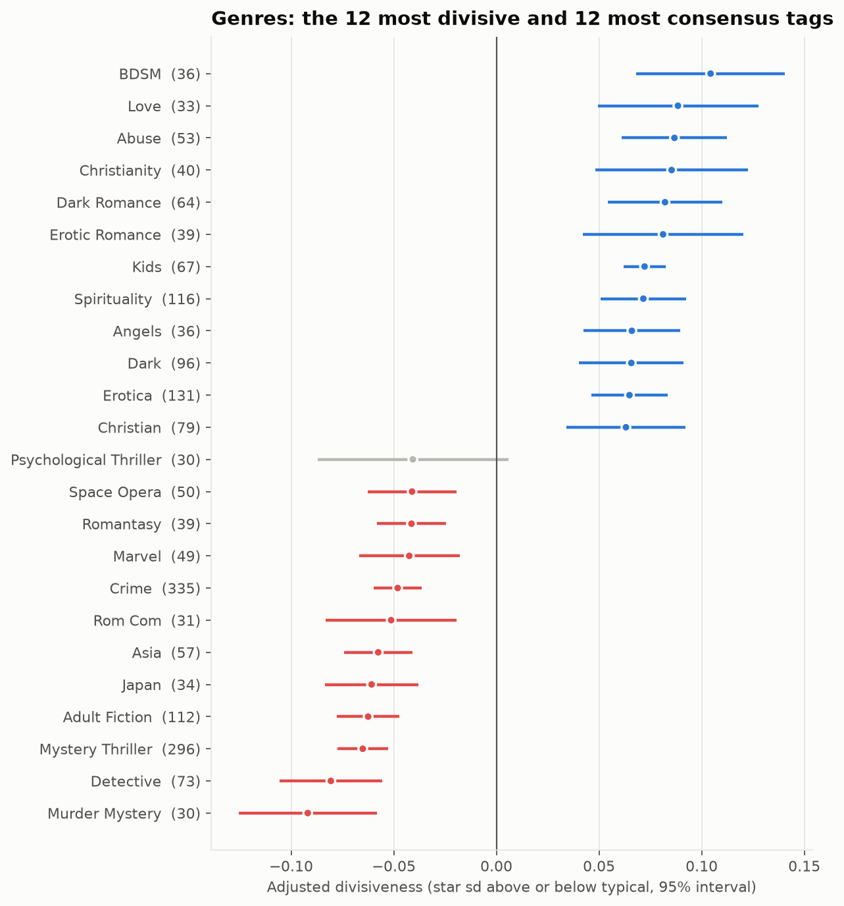
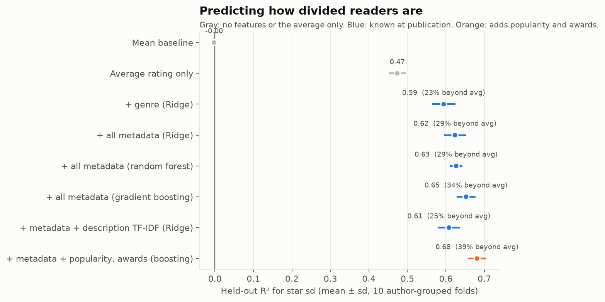

# What Makes a Story Stick?

### Critic and audience reception of films and books

Do the words in a review predict the rating it gives, and where do critics and audiences disagree? This project scrapes about 180,000 reviews from **Goodreads** (books) and **Rotten Tomatoes** (films, with separate critic and audience voices), cleans them, and tests each claim on data the model has never seen.

## Key findings

**1. Review text explains about half of reader and audience ratings on unseen titles, and about a quarter of critic ratings.** On a held-out 20% of books and films, TF-IDF + Ridge reaches R² 0.48 on Goodreads, 0.56 for RT audiences and 0.29 for RT critics.


| R² | Goodreads | RT audience | RT critics |
|---|---|---|---|
| Class version, scored on its own training data | 0.52 | 0.78 | 0.64 |
| Class version, held-out titles | 0.47 | 0.31 | 0.05 |
| Baseline: the title's published average | 0.06 | 0.30 | 0.50 |
| **Ridge on review text, held-out titles** | **0.48** | **0.56** | **0.29** |

**2. The original numbers were mostly overfitting.** The class version scored its models on their training data. On new films, its critic model falls from 0.64 to 0.05.

**3. Simple linear models beat trees and ensembles on review text.** Seven model families compete on the same held-out titles:

| Held-out R² | Goodreads | RT audience | RT critics |
|---|---|---|---|
| **Ridge** | **0.48** | **0.56** | **0.29** |
| Lasso | 0.48 | 0.56 | 0.26 |
| Random forest | 0.33 | 0.51 | 0.23 |
| Gradient boosting | 0.40 | 0.49 | 0.15 |
| Linear regression (OLS) | 0.48 | 0.40 | 0.06 |
| Decision tree | 0.15 | 0.35 | 0.06 |



Ridge wins on every platform, and Lasso nearly ties it while keeping only a quarter to half of the 5,000 terms. As a yes/no question (positive review or not), logistic regression and Naive Bayes reach ROC-AUC 0.83–0.91, and a single decision tree trails every other model. Ratings are a sum of many small word signals, which suits a linear model. Each tree split can only ask about one word, and any one word separates out only a small share of reviews. Scores hold up on reviewers the model never saw, so the models aren't leaning on who wrote the review.

**4. Readers disagree about the same book; critics converge on a film.** Which book a review is about explains 6% of Goodreads ratings, against 48% from the words. For critics, the film's average critic score (0.50) predicts better than the critic's own words (0.29).

**5. Critics and audiences speak differently.** Critics' negative words are craft diagnoses (*inept*, *incoherent*, *misfire*, *fails*) with coefficients about half the size of audiences' blunt verdicts (*worst*, *garbage*, *terrible*). On Goodreads, *dnf* ("did not finish") is the strongest signal of a low rating.

**6. Horror and documentaries split critics from audiences the most.** Critics score both about 16 points higher than audiences (on a 0–100 scale), while audiences favor biographies, music films and romance by 9–10 points. Genre alone explains only 8–14% of film scores, whichever model is used; for books, gradient boosting beats linear models (R² 0.26 vs. 0.21), suggesting genre combinations matter.


**7. The model misses pans that skip pan words.** In the 60 worst predictions: negation ("not a great movie"), sarcasm, objections to a book's message, and witty critic put-downs. That points to word-order-aware models next.

### Where critics and audiences disagree (`gap-analysis.ipynb`)

**8. Critics favor unrated, short, non-English, horror and documentary films; audiences favor PG-13, longer, Hindi-language and widely seen films.** Critics and audiences differ by 20+ points on 46% of the 2,454 films. PG-13 films average 13 points higher with audiences; unrated films 11 points higher with critics; films under 90 minutes 10 points higher with critics; French films 21.



**9. Before release, the gap is only partly predictable, but a split can be flagged.** Using only what's known before any review (genre, content rating, runtime, release timing, language, synopsis; no critic or audience scores), a random forest explains 17% of the gap on unseen films, double genre alone (8%). As a warning flag it works better: of the 10% of films it's most sure will split by 20+ points, 78% do, against a 47% base rate. Adding popularity after release lifts R² to 0.25.



**10. Many extreme gaps rest on a handful of ratings.** 40% of films have fewer than 50 audience ratings, and some audience scores come from 3. Sampling noise accounts for about 17% of the gap's variance (3–6% for well-rated films), so it doesn't cap the models (R² ceiling about 0.83), but it explains their biggest misses. The results hold on the 1,470 well-rated films.

### What makes a book divisive (`divisive-books.ipynb`)

**11. Subject matter that invites moral judgment splits readers; genre conventions unite them.** Divisiveness is the spread of a book's 1–5 star ratings, adjusted for its average (higher-rated books have less room to spread). Erotic and dark romance, Christian and spiritual books, and books about abuse are the most divisive for their averages; mysteries, detective and crime fiction the least. The most divisive widely read books include the King James Bible, *Fifty Shades of Grey*, *Atlas Shrugged*, *The Secret* and *Twilight*. First books in a series are more divisive than later volumes, likely because readers who disliked book one don't rate book three.



**12. Metadata known at publication explains about a third of the divisiveness the average rating doesn't.** On held-out authors, the average rating alone explains 47% of star spread; gradient boosting on genre tags, length, year and series raises that to 65%, or 34% of what was left (39% with popularity and awards). The publisher's description adds nothing. Results hold with a second measure (share of 1–2 star ratings).



---

## Research questions

1. **Review language and reception.** Do the words reviewers use predict the rating they give, on held-out titles? Do critics, audiences and readers signal approval with different words?
2. **Genre and the critic–audience split.** Which genres are associated with higher or lower ratings, and which genres do critics and audiences disagree on?
3. **Where do critics and audiences disagree, and can we predict it?** (`gap-analysis.ipynb`) Which film attributes go with the critic − audience gap, and can a model flag, before release, films that will split critics and audiences by 20+ points?

4. **What makes a book divisive?** (`divisive-books.ipynb`) Holding the average rating fixed, which books split readers instead of converging on a consensus?

Question 2 was a first pass; questions 3 and 4 replace it with sharper versions.

---

## Data

Scraped in spring 2026. Sizes are after `data-cleaning.ipynb`.

| Dataset | Rows | Key fields |
|---|---|---|
| Goodreads books | 4,997 books | average rating, 1–5 star counts, genres, description |
| Goodreads reviews | 135,361 reviews (127,040 English) | rating (1–5), review text |
| Rotten Tomatoes movies | 3,001 films (2,454 with both scores) | Tomatometer, audience score, genres, release year, runtime, content rating |
| RT critic reviews | 25,136 reviews | rating (parsed to 0–5), fresh/rotten, review text |
| RT audience reviews | 15,264 reviews | score (0.5–5), review text |

The raw and cleaned CSVs are not in the repo. Scraped review text isn't mine to redistribute, and the Goodreads reviews file alone is about 370 MB.

---

## Repository

```
├── data-collection.ipynb   # Runs the scrapers in src/story_reception/scrape/ -> data/*.csv
├── data-cleaning.ipynb     # Dedupe, join keys, language detection, text and rating cleaning, quality checks -> data/cleaned/
├── main.ipynb              # Analysis: held-out text models, model-family comparison, word and genre associations with intervals
├── gap-analysis.ipynb      # Critic − audience gap: pre-release features, nested-CV model ladder, split classifier, noise check
├── divisive-books.ipynb    # Book divisiveness: star spread adjusted for the average, author-grouped nested CV
├── src/story_reception/    # scrape/ (Goodreads + RT pipelines), clean.py, language.py, features.py, warehouse.py
├── sql/                    # DuckDB warehouse: staging/ loads CSVs, models/ builds tables, checks/ are data-quality rules
├── tests/                  # pytest: every critic-rating format, text cleaning, and a check against data/cleaned/ when present
├── Makefile                # make setup | test | lint | scrape | clean-data | warehouse | analysis | gap | books
├── pyproject.toml          # Package metadata and ruff settings
├── requirements.txt        # Pinned dependencies (tested on Python 3.14); requirements-dev.txt adds pytest and ruff
├── .github/workflows/      # CI: lint and tests on Python 3.12 and 3.14
├── figures/                # Charts used in this README, exported by main.ipynb on every run
└── data/                   # Not committed
    ├── goodreads-books.csv, goodreads-reviews.csv
    ├── rotten-tomatoes-movies.csv, rotten-tomatoes-critic-reviews.csv, rotten-tomatoes-audience-reviews.csv
    └── cleaned/            # Written by data-cleaning.ipynb
```

---

## Method

### Collection (`src/story_reception/scrape/`)

- Shared scraping layer: sync and async HTTP clients with exponential backoff, rotating user agents, handling for rate limits (429/403) and `Retry-After`, and a global pause so one rate-limit response pauses every concurrent request.
- Plugin design (`BaseDiscoverer`, `BaseDetailScraper`, `BasePipeline`), so a new source is a few subclasses.
- **Goodreads:** discovers Listopia lists by genre tag, then scrapes book pages asynchronously through the embedded `__NEXT_DATA__` Apollo cache.
- **Rotten Tomatoes:** Playwright for the JavaScript browse pages (on a background thread) feeding an async queue of detail and review scrapes.
- Resumable: discovered listings are cached to JSON, and CSVs are written in append mode.

### Cleaning (`data-cleaning.ipynb`)

- **Deduplication by ID,** not exact row. The same book scraped from several lists had slightly different counts, so exact matching missed 789 duplicate books and about 5,200 duplicate reviews.
- **Join keys:** reviews link to books by `book_id` and to films by URL, not by title (21 Goodreads titles belong to more than one book).
- **Language:** each review is labeled with [Lingua](https://github.com/pemistahl/lingua-py) (30 candidate languages, run on the raw text).
- **Text:** HTML, URLs and mojibake are removed. Accents are transliterated (`cliché` → `cliche`) rather than deleted, and remaining non-ASCII is removed.
- **Critic ratings:** `parse_critic_rating` turns 15+ formats (`3/5`, `B+`, `3 1/2 stars`, `7/10`, `Must Watch`, ...) into 0–5 and rejects off-scale values like `7.5/5`.
- **One 0–1 scale:** Goodreads (r − 1) / 4, RT audience (s − 0.5) / 4.5, critics r / 5.
- **Quality checks** fail the notebook if keys repeat, joins break, ratings leave 0–1, or text isn't clean.

### Warehouse (`sql/`, `make warehouse`)

The cleaned CSVs are loaded into a local DuckDB database (`data/reception.duckdb`) and modeled in plain SQL files: `films`, `film_genres`, `critic_reviews`, `audience_reviews`, `books` (with a divisiveness measure: the spread of each book's 1–5 star ratings), `book_genres`, `book_reviews`, `film_gap` (critic − audience per film) and `genre_gap`. Five check queries (unique keys, missing keys, orphan reviews, scores on scale, derived values) must each return zero rows, or the build fails. The whole build takes about 5 seconds.

```sql
-- Which widely read books split readers the most?
SELECT title, star_count, round(avg_rating, 2) AS avg_rating, round(star_sd, 2) AS star_sd
FROM books WHERE star_count >= 10000 ORDER BY star_sd DESC LIMIT 5;
```

| title | star_count | avg_rating | star_sd |
|---|---|---|---|
| Leaving Isn't the Hardest Thing | 10,580 | 3.43 | 1.52 |
| The Book of Mormon | 91,732 | 4.23 | 1.45 |
| Fifty Shades of Grey | 2,893,045 | 3.67 | 1.36 |
| Atlas Shrugged | 409,308 | 3.69 | 1.31 |
| Twilight | 7,398,289 | 3.68 | 1.30 |

### Analysis (`main.ipynb`)

- **Held-out by title.** 20% of books and films are held out, so every test review is of a title the model never saw.
- **Baselines.** Predict the average; predict the title's published average.
- **TF-IDF + Ridge,** with the penalty chosen by 5-fold cross-validation grouped by title, compared with the class version's unregularized regression scored both ways.
- **95% bootstrap intervals** (titles resampled 200 times) on every word coefficient. Only words whose interval excludes zero are interpreted.
- **Seven model families** on the same split: OLS, Ridge, Lasso, decision tree, random forest and gradient boosting for the rating; logistic regression (L2 and L1), Naive Bayes and the same tree models for positive vs. negative. Settings are chosen on a validation split of the training titles.
- **Reviewer leakage check:** every model is also scored on held-out reviews from reviewers absent from training. (A split that separates both titles and reviewers isn't possible: shared reviewers link 95–100% of reviews into one cluster.)
- **Error analysis** of the 20 worst held-out predictions per platform.
- **Genre models** on films with both scores (no median-filling), genres with 30+ titles, and the critic − audience gap modeled directly, with repeated-CV R² and 1,000-resample intervals. The same model families are compared by nested cross-validation, plus a three-class decision tree for films that split critics and audiences by 20+ points.

### Gap analysis (`gap-analysis.ipynb`)

- **Target:** Tomatometer − audience score for the 2,454 films with both. A second target flags a split of 20+ points either way.
- **No leakage:** no feature is built from either score (no top-critic score, average ratings, consensus text or sentiment). `features.py` builds pre-release features (genre, content rating, runtime, release year and month, language) and post-release ones (rating counts); a test checks that changing the scores leaves the features unchanged.
- **Models:** mean baseline, Ridge, random forest and gradient boosting, on metadata alone and with the synopsis as TF-IDF or MiniLM sentence embeddings. All use nested CV: 10 outer folds, settings tuned by inner 3-fold CV, imputation and vectorizers fit inside folds.
- **Explanation:** shuffle importance by feature family on held-out folds, Ridge coefficients, partial dependence on runtime, and out-of-fold case studies.
- **Noise check:** each score's sampling variance from its rating count gives the unpredictable share of the gap and an R² ceiling; the models are refit on films with 50+ audience ratings.

### Divisiveness (`divisive-books.ipynb`)

- **Sample:** 3,794 Goodreads books with 100+ star ratings and full metadata (716 books whose detail page wasn't scraped are left out).
- **Target:** standard deviation of each book's 1–5 star ratings. The average rating enters every model as a control (a spline for linear models), and results are reported as the share of remaining variance explained beyond it.
- **Features (`features.py`):** reader genre tags with 30+ books, log page count, publication year, series membership and position (capped so comic issue numbers and box sets don't dominate); post-publication popularity and award counts kept separate.
- **No author leakage:** outer and inner (tuning) splits are GroupKFold by author, so no author's books are on both sides; boosting's rounds are tuned that way too, not by its built-in (ungrouped) early stopping.
- **Intervals clustered by author** for the group comparisons; box sets and series books without a listed position are kept apart from first and later volumes.
- **Robustness:** the same models on the share of 1–2 star ratings.

---

## Setup

```bash
make setup                                # .venv with pinned dependencies, dev tools and this package
make test                                 # unit tests (plus checks against data/cleaned/ if present)
.venv/bin/playwright install chromium     # only needed to re-scrape Rotten Tomatoes
```

Without `make`: `python3 -m venv .venv && .venv/bin/pip install -r requirements.txt -r requirements-dev.txt && .venv/bin/pip install -e .`

Run the notebooks in order: `data-collection.ipynb` → `data-cleaning.ipynb` → `main.ipynb` (or `make clean-data analysis`), then `gap-analysis.ipynb` (`make gap`, about 10 minutes) and `divisive-books.ipynb` (`make books`, about 8 minutes). With the raw CSVs already in `data/`, skip collection. On a laptop, cleaning takes about 1.5 minutes and the analysis about 15 (mostly the tree models and Lasso on 98k Goodreads reviews).

To scrape (hours per source; check each site's terms first):

```bash
.venv/bin/python -m story_reception.scrape goodreads rottentomatoes --output-dir data
# or: make scrape SOURCES=goodreads, or uncomment a line in data-collection.ipynb
```

---

## Limitations

- **Not a random sample.** Books come from popular Goodreads lists and films from RT browse pages, so ratings skew high.
- **Thin RT reviews.** The median film has about 10 critic and 6 audience reviews in this data.
- **English only** for the text models.
- **TF-IDF ignores word order** beyond two-word phrases.
- **Associations, not effects.** Coefficients describe which titles and reviews tend to score higher, not what would change a rating.
- **One snapshot.** Scores drift as reviews accumulate, especially for recent releases.

---

Started as a group class project and rebuilt (cleaning, evaluation and analysis) by Michael-Andre Odusami.
